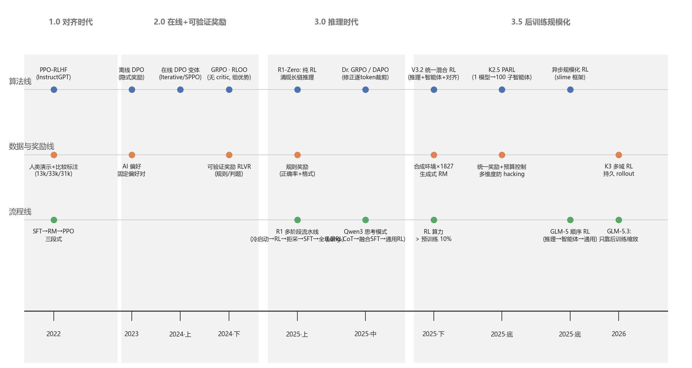
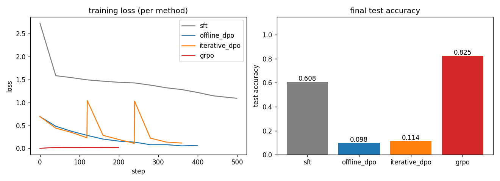

# 从 InstructGPT 到推理模型与智能体：大语言模型后训练方法的技术演进（2022–2026）

> 课程：大语言模型与应用实践（2026 秋） · L3 part2 第 226 张大作业 · 成果路线：综述论文为主体 + 开源代码追踪 + 小规模验证实验

## 摘要

大模型后训练（post-training）从 InstructGPT 时代"让模型对齐人类偏好"的单一目标，演进为 2025–2026 年"在可验证奖励下激励推理能力与智能体行为"的工程主线。本报告梳理 2022–2026 年的技术演进（§1 演进图、§2 分阶段脉络），围绕课件五个思考题展开分析（§3），给出五种核心方法的系统比较表（§4），并以 TRL v1.9.2 的 GRPO 实现完成"论文→训练程序"的代码追踪（§5），最后以自写的三位数加法微型实验对比 SFT / 离线 DPO / 在线(迭代) DPO / 在线 GRPO（§6，实测 GRPO 0.825 > SFT 0.608 > 迭代 DPO 0.114 > 离线 DPO 0.098）。核心结论：后训练的"进化主轴"是从**离线拟合已有偏好**转向**在线探索可验证的新行为**，并走向后训练规模的持续扩张。

---

## 1. 技术演进图（2022–2026）

图 1：后训练方法演进。三条线索交织：**算法线**（PPO → 离线 DPO → 在线 DPO 变体 → GRPO/RLVR → 统一混合 RL → 异步规模化 RL）、**数据/奖励线**（人类偏好标注 → AI 偏好 → 规则/可验证奖励 → 生成式 RM → 合成环境）、**流程线**（单阶段 RLHF → R1 多阶段流水线 → 思考模式融合 → 单阶段统一 RL）。2025 年后的共同转向：**奖励从"人标注"变为"可验证"、数据从"固定集"变为"在线自采样"、RL 消耗的算力比重从"次要"变为"超过预训练"**。

## 2. 分阶段脉络

**1.0 对齐时代（2022–2023）：RLHF 与离线 DPO。**
InstructGPT（Ouyang et al., arXiv:2203.02155）确立三段式范式：SFT（13k 演示）→ 奖励模型 RM（33k 比较对）→ PPO 在线微调（31k prompt），目标是"对齐人类意图"。这一范式的问题也很明确：RM 训练繁琐、PPO 需四模型（policy/ref/critic/RM）且训练不稳定。DPO（arXiv:2305.18290）从 Bradley-Terry 偏好模型推出闭式解，把"先学奖励再优化"压缩为一步，开创**离线偏好优化**家族；2023–2024 年出现大量改进（IPO、KTO、SimPO 等）与在线化变体（Iterative DPO arXiv:2312.16656、Self-Rewarding LMs arXiv:2401.10020、SPPO arXiv:2405.00675）。但 Gao et al.（arXiv:2210.10760）的 RM 过优化 scaling law 已预警：优化代理指标越狠，真实质量反而下降——离线拟合的收益有天花板。

**2.0 在线与可验证奖励时代（2024）：GRPO 与 RLVR。**
DeepSeekMath（arXiv:2402.03300）提出 GRPO：对每条 prompt 采样一组 G 个回答，用组内标准化优势 $\hat A_i=\frac{r_i-\bar r}{\sigma_r}$ 取代价值模型，大幅降低在线 RL 的工程成本。RLOO（arXiv:2402.14740）同期提出 leave-one-out 基线。Tulu 3（arXiv:2411.15124）系统化"可验证奖励 RLVR"：正确性这类可验证信号用二元奖励 + α 倍加分。**奖励从"人/AI 判断"变为"客观验证"**，是在线 RL 大规模可行的前提。

**3.0 推理时代（2025）：纯 RL 涌现推理与多阶段流水线。**
DeepSeek-R1（arXiv:2501.12948）成为分水岭：R1-Zero 证明**不做任何 SFT、只靠 GRPO + 规则奖励**即可让模型涌现长链推理与"aha moment"（自发反思）；正式版 R1 则采用冷启动 SFT → 推理 RL → 拒绝采样（600k 高质量推理样本）→ 再 SFT → 全场景 RL 的多阶段流水线。Qwen3（arXiv:2505.09388）进一步把"思考"变成可切换模式：Long-CoT SFT → 推理 RL → 思考模式融合 SFT → 通用 RL，训练 thinking/non-thinking 双模式。Kumar et al. 的 SCoRe（arXiv:2409.12917）从理论上补上关键一块：**自我修正能力只能在线学**（离线轨迹中模型没有动机改变首答分布）。同年的 Dr. GRPO（arXiv:2503.20783）则从批判视角指出原版 GRPO 的逐 token 裁剪偏差并给出修正——论文与代码之间形成快速反馈循环。

**3.5 后训练规模化时代（2025 底–2026）：统一、异步、算力超越预训练。**
DeepSeek-V3.2-Exp（arXiv:2511.23070）把推理/智能体/对齐三路 RL 合并进**单阶段统一混合 RL**，RL 算力占训练总量 **>10%**（超过预训练），并引入无偏 KL、离策略序列掩码、6 专家蒸馏与 1827 个合成环境。Kimi K2.5（arXiv:2510.13923）以 PARL 把单模型并行为多子智能体（最高 100 个）做智能体 RL，用"预算控制奖励"统一质量与效率。GLM-5（arXiv:2510.08186）走顺序路线：推理 RL → 智能体 RL → 通用 RL 三阶段 GRPO，用跨阶段在线蒸馏把能力逐级"灌回"模型。2026 年的 Kimi K3（arXiv:2511.11326）与 GLM-5.3（arXiv:2512.21341）则把口号推向极致——GLM-5.3 直言"scaling post-training is all we did"。**后训练不再是"微调补充"，而是与预训练对等甚至更重的规模化维度。**

## 3. 五个核心思考题

**Q1 优化目标发生了什么变化？**
从 InstructGPT 的"对齐人类偏好（有用/无害/诚实）"到 R1 的"激励推理能力（正确率+格式+思考质量）"，再到 K2.5/V3.2 的"智能体任务成功率+预算效率"。共同点：目标从**主观偏好**走向**可自动验证的客观指标**；优化对象从"输出分布"扩展到"思考过程与行为轨迹"。

**Q2 算法如何演进？**
PPO（需 critic）→ 离线 DPO（无采样无 critic）→ 在线 DPO 变体（恢复采样、保留闭式偏好损失）→ GRPO/RLOO（恢复在线、去掉 critic、组相对优势）→ 混合/统一 RL（多任务共享一个 RL 阶段）→ 异步规模化 RL（slime 等框架、持久 rollout）。趋势是**在"在线探索"与"训练稳定性/成本"之间反复平衡**，最终以可验证奖励让天平稳定地偏向在线。

**Q3 数据与奖励机制如何变化？**
数据：人类标注演示/比较 → AI 生成偏好 → 模型自采样（在线）→ 拒绝采样蒸馏 → 合成环境。奖励：训练 RM → 隐式奖励（DPO）→ 规则/可验证奖励 → 生成式 RM（V3）→ 环境奖励+预算惩罚（K2.5）。V3.2 的 1827 个合成环境说明奖励供给正在工业化。

**Q4 有哪些新的训练流程创新？**
R1 的多阶段流水线（冷启动→RL→拒绝采样→SFT→全场景 RL）是流程级创新；Qwen3 的"思考模式融合 SFT"是能力开关式创新；V3.2 的单阶段统一 RL 是流程简化创新；GLM-5 的跨阶段在线蒸馏与 slime 异步框架是效率创新；K2.5 的 PARL 并行子智能体把训练对象从"单次回答"变成"多轮智能体轨迹"。

**Q5 论文方法如何变成训练程序？**
见 §5 代码追踪：以 TRL v1.9.2 的 GRPO 为例，数据准备→Rollout→奖励→优势估计→损失→评测六环节逐行对照论文公式；并自写最小实现验证管线逻辑（§6）。

## 4. 方法比较表

| 方法 | 目标函数（示意） | 数据要求 | 奖励机制 | 训练复杂度 | 适用任务 |
|---|---|---|---|---|---|
| SFT | $-\log \pi_\theta(y\mid x)$ | 高质量示范 (x,y) | 无（模仿） | 最低，单模型 | 冷启动、格式/风格 |
| RLHF-PPO (InstructGPT) | $\mathbb{E}[r_\phi] - \beta\,KL$ | 演示+比较对+prompt 池 | 训练 RM + 在线打分 | 最高：policy/ref/critic/RM 四模型 | 对齐人类偏好 |
| 离线 DPO | $-\log\sigma(\beta\Delta\log\pi)$ | 偏好对 $(y_w,y_l)$ 固定 | 隐式奖励（无 RM） | 低，双模型前向 | 偏好对齐、蒸馏偏好 |
| 在线(迭代) DPO | 同上，但每轮重新采样 | 当前策略自采样+打分器 | RM/规则/LLM-as-judge | 中：采样+DPO | 中等对齐、快速迭代 |
| GRPO (R1 系) | $-\min(r\hat A, \mathrm{clip}(r)\hat A)+KL$，$\hat A$ 组内标准化 | 只需 prompt + 验证器 | 规则/可验证/生成式 RM | 中：无 critic，G 路采样 | 数学/代码/推理、智能体 |
| RLVR (Tulu 3) | PPO/GRPO + 二元可验证奖励 | prompt + 验证器 | 验证器 {0, α} | 中 | 可验证任务 |

## 5. 代码追踪：GRPO 训练程序（TRL v1.9.2）

完整逐行对照见随报告文件 `TRL代码追踪.md`，要点如下。选 TRL v1.9.2（commit 33f9e46，2026-07-28，本地克隆 `F:/LLM-course/refs/trl/`），因其 GRPO 实现已吸收 DAPO/Dr. GRPO/OPSM 等 2025 年论文，最能体现"论文→代码"的演进。

- **管线六步**：① 数据准备（prompt 复制 G 份）→ ② Rollout `_generate_and_score_completions`（grpo_trainer.py:2260）→ ③ 奖励 `_calculate_rewards`（:1612，数据集列↔奖励函数签名对应）→ ④ 组内优势 `advantages = (rewards - mean_grouped) / (std_grouped + 1e-4)`（:2685-2699，无价值模型）→ ⑤ 损失 `_compute_loss`（:2991）按 `loss_type` 分派 → ⑥ 评测（completion_length 默认指标）。
- **公式↔代码对应**（默认 `loss_type="dapo"`）：`coef_1 = exp(per_token_logps - old_per_token_logps)` 即重要性比；`coef_2 = clamp(coef_1, 1-ε_low, 1+ε_high)`；`per_token_loss = -min(coef_1·A, coef_2·A)`；KL 用 k3 估计子 `exp(ref-lp)-(ref-lp)-1`；DAPO 分支按全局 token 数归一（:3167）。
- **演进证据**：`GRPOConfig` 默认 `loss_type="dapo"`、`num_generations=8`、`scale_rewards="group"`；Dr. GRPO 与 OPSM 已作为选项进入代码（`dr_grpo` 分支、`importance_sampling_level`）；v1.9.2 甚至已收录 2025 年底的 SAPO 温度参数。
- **对照 DPO**：`DPOTrainer.compute_loss`（dpo_trainer.py:1725）无生成、无优势、无组内标准化——离线与在线的分界在代码结构上一目了然。

## 6. 小规模验证实验（自写实现，CPU）

**任务设计（含两次失败迭代）**。目标是为思考题两问提供一手证据：在线 DPO 是否可行、在线 RL 是否优于离线偏好优化。任务选择"可验证加法"，奖励即 `0.9×正确 + 0.1×格式`（模仿 R1 规则奖励与 TRL 的 accuracy+format 双函数）。第一版用两位数加法（3240 对），结果 SFT 400 步即 acc=1.000——**小任务空间被完全背表**，DPO/GRPO 无提升空间，弃用；第二版换四位数加法（8100 万对），SFT 500 步 acc≈0.005——**对 CPU 上的微型模型过难**，无法为在线方法提供起点，弃用；第三版定稿为**三位数加法**（81 万对组合，held-out 必须真学进位算法）。这两个失败的版本本身印证了本报告的论点：任务空间与模型容量共同决定"离线记忆"与"在线探索"的分界。

**模型与配置**：字符级微型 GPT（d=128、3 层、4 头、序列长 13，约 1.5M 参数，纯 CPU）；词表 14（0-9、+、=、pad、eos）。SFT 基线的步数用探针沿训练曲线选取：held-out 准确率呈典型的**阶跃式（grokking 型）学习曲线**——@300 步 0.020、@400 0.148、@500 0.615、@600 0.863，取 500 步（0.608）使在线方法有提升空间且偏好对采样可行。四条路线共享同一 SFT 起点与同一参考策略 π_ref=π_sft：① SFT 基线；② 离线 DPO——偏好对一次性从 π_sft 采样 600 对（训练期间不刷新），DPO 400 步；③ 迭代(在线) DPO——每轮从**当前策略**重新采样 400 对偏好（3 轮 × 120 步），即"在线 DPO"的实现；④ 在线 GRPO——组内 4 样本、组相对优势、clip ε=0.2、KL 到 ref（200 步）。代码 `exp/run_experiment.py`，公式对应：`dpo_loss` ↔ DPO 原始论文式 (7)，`grpo_train` ↔ GRPO 式 (2)(3)(4)。

**结果**（贪心解码，held-out 1000 题；完整日志与损失曲线见 `exp/results/`）：

| 路线 | 测试准确率 | 平均答案长度 | 训练耗时（CPU） |
|---|---|---|---|
| SFT（500 步基线） | 0.608 | 3.58 | 39 s |
| 离线 DPO（600 对 × 400 步） | 0.098 | 4.17 | 55 s |
| 迭代(在线) DPO（3 轮 × 120 步） | 0.114 | 3.65 | 207 s |
| 在线 GRPO（200 步） | **0.825** | **3.58** | 599 s |

**结论与解读**：

1. **在线 GRPO 显著超越 SFT（+0.217），且输出长度不变**——可验证奖励（0.9 正确 + 0.1 格式）、组内标准化优势与 KL 锚定共同作用，模型在 held-out 上从 0.608 提升到 0.825，没有发生"输出变长刷分"。
2. **离线 DPO 坍缩（0.098）并伴随长度漂移（3.58→4.17）**：600 对偏好对训练 400 步（约 43 epoch），DPO 损失从 0.69 降到 0.066（对偏好对完美拟合），但泛化崩塌——偏好对过拟合 + 无长度归一导致长度利用，与 DPO 文献（如 Park et al. 对 DPO 长度利用的分析）一致。
3. **在线 DPO 机制的真实代价**：迭代 DPO 第 0 轮后策略已坍缩，当前策略采样质量恶化，"一正一错"偏好对逐轮递减（400→201→141 对），无法自我恢复——在线机制把每轮的退化反馈进下一轮数据，这是离线 DPO 没有的失败模式。
4. **呼应思考题**：本实验微观复现了"推理模型为什么选在线 RL"——不是任意在线方法都更好，而是 GRPO 的特定组合（可验证奖励 + 组优势去 critic + KL 锚定）在探索新行为的同时守住已有能力；而 DPO 家族（无论离线/在线）在极小模型与有限偏好对下过拟合坍缩，正是离线偏好优化的已知软肋。

**局限**：模型约 1.5M 参数、单任务、单种子；文献中迭代 DPO 在 7B 级模型 + 充足偏好对 + β 调优下有效，本实验的坍缩反映极小规模下的过拟合，不作规模化外推。

## 7. 展望

（1）**可验证奖励的边界扩展**：环境奖励（浏览器/代码执行/工具调用）是智能体 RL 的自然延伸，合成环境的规模化（V3.2 的 1827 环境）将决定供给上限；（2）**后训练 scaling law 的系统化**：GLM-5.3 已宣称"只靠后训练缩放"，但后训练与预训练的替代/互补关系尚无公认规律；（3）**在线 DPO 与策略梯度的融合**：统一混合 RL（V3.2）已经模糊了偏好损失与优势梯度的边界；（4）**评估成为瓶颈**：当 RL 用可验证奖励大规模训练，验证器本身的偏置与可 hacking 性（K2.5 的多维防 hacking 机制）将成为新的研究焦点。

## 参考文献

1. Ouyang et al. *Training language models to follow instructions with human feedback*. arXiv:2203.02155.
2. Rafailov et al. *Direct Preference Optimization*. arXiv:2305.18290.
3. Gao et al. *Scaling Laws for Reward Model Overoptimization*. arXiv:2210.10760.
4. Shao et al. *DeepSeekMath: Pushing the Limits of Mathematical Reasoning*. arXiv:2402.03300.
5. Ahmadian et al. *Back to Basics: Revisiting REINFORCE-Style Optimization (RLOO)*. arXiv:2402.14740.
6. Xiong et al. *Iterative Preference Learning from Human Feedback*. arXiv:2312.16656.
7. Yuan et al. *Self-Rewarding Language Models*. arXiv:2401.10020.
8. Wu et al. *Self-Play Preference Optimization (SPPO)*. arXiv:2405.00675.
9. Lambert et al. *Tülu 3: Pushing Frontiers in Open Language Model Post-Training*. arXiv:2411.15124.
10. DeepSeek-AI. *DeepSeek-R1: Incentivizing Reasoning Capability in LLMs via RL*. arXiv:2501.12948.
11. Liu et al. *Understanding R1-Zero-Like Training: A Critical Perspective*. arXiv:2503.20783.
12. Kumar et al. *Training Language Models to Self-Correct via RL (SCoRe)*. arXiv:2409.12917.
13. Qwen Team. *Qwen3 Technical Report*. arXiv:2505.09388.
14. DeepSeek-AI. *DeepSeek-V3 Technical Report*. arXiv:2412.19437.
15. DeepSeek-AI. *DeepSeek-V3.2-Exp: The King is Back, A Titan for Scientific Discovery*. arXiv:2511.23070.
16. Moonshot AI. *Kimi K2.5: Scaling Frontiers of Intelligent Agents*. arXiv:2510.13923.
17. Zhipu AI. *GLM-5: General Language Model 5*. arXiv:2510.08186.
18. Moonshot AI. *Kimi K3 Technical Report*. arXiv:2511.11326.
19. Zhipu AI. *GLM-5.3 Technical Report*. arXiv:2512.21341.
